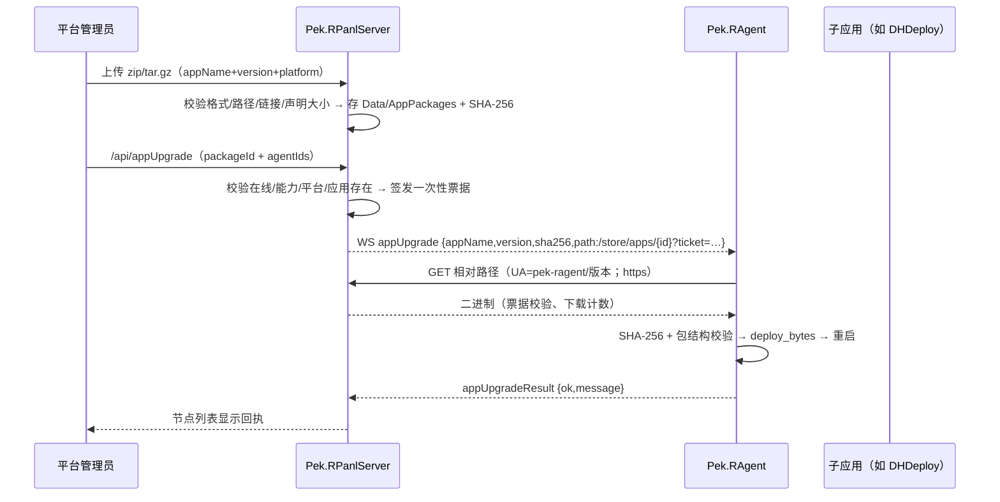

# 远程子应用升级 · 全量审计与安全审计（2026-10-27）

> 范围：Pek.RAgent 0.1.94（子应用清单上报 + `appUpgrade` 执行）、Pek.RPanlServer 0.1.67（应用包管理 + 自动识别 + 下发）、DH.RustBase 0.5.7（受限 zip 解压）。
> 用户要求：「实现后，要做全量审计和安全审计，确保功能逻辑和安全上是没有问题的」「另外也要针对带宽消耗、性能、资源占用等统一分析调优」。

## 1. 结论

- **功能闭环已打通**：平台上传应用包 → 选择节点下发 → Agent 下载/校验/部署/重启 → 平台收到回执并在节点列表展示。
- **权限与信任边界明确**：只有平台管理员（`agents` 权限）能上传/下发；Agent 只接受平台相对路径、只升级本机已有应用；下载票据一次性、短时效。
- **发现并修复 11 项问题**（详见第 5 节），其中 5 项为高/中风险：zip bomb/链接逃逸、下载票据落日志、数据库文件名路径穿越、公网并发下载内存峰值、节点名称/标识内联 JS 注入面。
- **未新增周期任务**：应用清单只在变化时随心跳上报，包只在明确下发时下载，不产生后台轮询流量。
- **回归**：RAgent 215 测试全绿、平台 70 测试全绿、DH.RustBase 331 测试全绿（zip 相关 8 项）+ clippy 零告警。

## 2. 数据流与信任边界

信任边界：

- 平台 → Agent 的 WS 通道使用节点专用令牌（已有机制）；应用包下载走同一平台 origin。
- 应用包是**可执行内容**，平台管理员权限等同于节点代码执行权限；必须只授予可信管理员（见残余风险）。
- Agent 不信任平台下发的路径/SHA/包内容：路径必须相对且无穿越，SHA 必须匹配，包必须通过结构与大小限制。

## 3. 功能审计

| 检查项 | 结果 | 说明 |
|---|---|---|
| Agent 注册/心跳上报子应用 | 通过 | `register` 全量；心跳仅在签名变化时带 `apps`，其余为 `null` |
| 平台持久化子应用 | 通过 | `Panl_AgentNode.Apps`（Text，20KB 上限），注册/心跳均可刷新 |
| 平台展示子应用 | 通过 | 节点「子服务」列可展开名称/运行状态/pid；旧 Agent 显示运行数/总数 |
| 上传应用包 | 通过 | 仅 zip/tar.gz 魔数；结构、路径、链接、声明大小校验；同应用+平台+版本唯一 |
| 应用包自识别 | 通过 | 应用名/平台从包内 ELF/PE 主程序头识别；版本从文件名 `vX.Y.Z`/`X.Y.Z` 识别；三项留空即可上传，手填应用名/版本可覆盖；**目标平台不在 UI 手选，始终以包内主程序为准**，手填平台与包不符直接拒绝 |
| 下发前置校验 | 通过 | 在线、`appUpgrade` 能力、平台一致、节点已存在同名应用；单次 ≤500 节点 |
| Agent 下载 | 通过 | 只接受 `/` 开头相对路径；origin 来自 `AutoUpgradeUrl`；180s 超时、64MB 上限 |
| 完整性 | 通过 | SHA-256 强制校验；包格式再由 `deploy_bytes` 按魔数确认 |
| 部署 | 通过 | 复用 `apppkg::deploy_bytes`：解压→定位主程序→拷贝→upsert 配置→重启 |
| 回执 | 通过 | 成功/失败均回 `appUpgradeResult`；平台落内存并在节点列表显示；失败含具体原因 |
| 失败可定位 | 通过 | 下载/HTTP 状态/校验/部署/启动失败分别给出文案，含节点路径或状态码 |
| 旧版本兼容 | 通过 | 旧 Agent 不上报 `apps`、无 `appUpgrade` 能力 → 平台按钮隐藏/接口拒绝并提示升级 |

## 4. 安全审计

### 4.1 认证与授权

- 平台侧所有应用包接口（上传/列表/删除/下载/下发/回执）均 `require_perm(..., "agents")`；未登录/无权限返回统一错误。
- 公开面只有 `GET /store/apps/{id}?ticket=…`，**必须**携带票据；无票据固定 403，不泄露包是否存在。
- 票据：192 位随机（`dhrust::random::hex(24)`）、绑定包 id、TTL 10 分钟、最多 3 次；平台重启即失效。
- Agent 侧 `appUpgrade` 来自已鉴权的 WS 通道；执行前再次校验应用已存在，避免远程新建任意服务。

### 4.2 输入与路径

- `appName` ≤60 且仅 `[A-Za-z0-9._-]`；`version` ≤50 且仅 `[A-Za-z0-9._+-]`；`platform` ≤30；均拒绝 `.`/`..`。
- 存储文件名由平台生成（应用+版本+平台+扩展名），不接受客户端文件名。
- DB 读取文件名时再次校验（`safe_file_path`），防数据库被篡改后的 `../` 逃逸。
- 上传 zip：`enclosed_name()` 为空 → 拒绝；tar.gz：绝对路径/`..`/盘符前缀 → 拒绝。
- 解压：zip 拒绝符号链接；tar.gz 拒绝符号链接/硬链接/设备/FIFO；路径穿越拒绝。
- Agent 下载路径：必须 `/` 开头、非 `//`、不含 `..`/`\`/空白/控制字符、长度 ≤2048。

### 4.3 资源型攻击（zip bomb / 大包）

- 平台上传：声明解压总量 ≤512MB、条目 ≤20000；超限直接拒绝。
- Agent 解压：`dhrust::zip::extract_zip_limited` 按**实际写入字节**累计（不信任 ZIP 中央目录的 `size`），流式写临时文件，超限删除临时文件并报错；tar.gz 按条目声明大小累计并限制条目数。
- 单包压缩体积 ≤64MB（平台上传与 Agent 下载双重限制）。
- 平台应用包并发下载上限 3；Agent 应用升级串行锁（RAII，panic 也会释放）。

### 4.4 SSRF / 任意 URL

- 平台下发给 Agent 的是**相对路径**，不把公网地址写死；Agent 用自身 `AutoUpgradeUrl` 的 scheme+authority 拼接。
- 仅 https；仅回环地址允许 http（与自动升级/插件源既有策略一致）；authority 含 `@`（userinfo）拒绝。
- 因此平台被冒充时，Agent 也不会被诱导去任意内网地址下载。

### 4.5 凭据与日志

- **修复**：Agent 原先在「开始下载」日志与下载失败文案里打印完整 URL（含 `ticket=`），票据会落节点日志/平台回执；现统一 `redact_url_ticket` 为 `ticket=***`。
- 平台日志记录包名/版本/平台/大小/操作人/节点，不记录票据。
- Agent 审计（`appUpgrade`）记录平台来源、应用、版本、成功/失败与原因；不记录票据。
- 平台结果回执仅保存应用/版本/消息/时间，不保存下载 URL。

### 4.6 WAF 与 HTTP 层

- 应用包上传加入 `skip_attack_prefixes`（大报文逐字节正则会误报/拖慢），但仍有 Bearer 鉴权、字段白名单与体积上限。
- `/api` 机器调用继续豁免 UA 机器人检测（Agent/面板工具 UA 已统一）；`/store/apps` 不豁免攻击检测，票据为 hex，不触发规则。
- 平台 HTTP 默认 64MB body 上限与应用包上限一致；无 multipart 解析开销。

### 4.7 审计记录

- 平台无独立操作日志表（现状），本轮在应用包上传/删除/下发日志中补充**操作人**；后续如平台引入统一审计表，可直接迁移。
- Agent 审计表新增 `appUpgrade` 动作（平台来源），成功/失败均记录，含失败原因（≤审计字段长度）。

## 5. 发现与修复清单

| # | 风险 | 级别 | 处理 |
|---|---|---|---|
| 1 | zip 解压只按声明 size 预分配，恶意包可实际解压远超声明（zip bomb） | 高 | `extract_zip_limited` 按实际写入字节流式限制 512MB/20000 条；平台上传先按声明值粗筛 |
| 2 | tar 符号链接/硬链接可造成链接逃逸 | 高 | 平台与 Agent 双侧拒绝链接/设备/FIFO |
| 3 | 下载票据出现在 Agent 日志与错误回执 | 高 | `redact_url_ticket` 统一脱敏 |
| 4 | 多节点同时下载 64MB 包导致平台内存峰值 | 中 | 平台并发下载上限 3（票据不因并发满被消耗） |
| 5 | DB 中文件名若被篡改可路径穿越 | 中 | `safe_file_path` 读取时二次校验 |
| 6 | 上传并发可能重复写同名包/重复行 | 中 | 上传串行锁 + DB 失败清理落盘文件 |
| 7 | Agent 应用升级互斥锁 panic 后不释放 | 中 | RAII `BusyGuard` |
| 8 | 应用名大小写不一致导致“节点上不存在”误判 | 低 | Agent 按大小写不敏感匹配实际应用名再部署 |
| 9 | 平台日志无操作人，事后无法追溯 | 低 | 上传/删除/下发日志补操作人 |
| 10 | 节点标识由 Agent 任意上报，被拼进面板内联 `onclick` 可造成脚本注入 | 中 | 平台只接受 `[A-Za-z0-9._-]`（≤64）标识；旧库非法标识不展示、不推送；新增 `agent_id_rejects_script_hostile_chars` 测试 |
| 11 | 节点名称含引号/尖括号可破坏内联 JS/HTML | 低 | `safe_display` 清理控制字符与引号/反引号/尖括号，展示层仍统一 `esc` |

## 6. 带宽 / 性能 / 资源分析

### 6.1 带宽

- **不新增周期请求**：应用清单搭 `register`/`heartbeat` 便车；心跳仅在签名变化时携带 `apps`，无变化发 `null`。
- 应用清单只含必要字段（name/file/mode/enable/running/pid/healthFails），不传启动参数/环境变量（可能含凭据）。
- 应用包仅在管理员点击下发时下载一次；下载是顺序流（Agent 端 `blocking_request_offthread`），无并发预取。
- 平台节点列表现有 60 秒轮询不变；应用包列表只在进入页面/操作后刷新，不参与轮询。

### 6.2 性能

- Agent 心跳每 60 秒一次 `manager.list()`，本轮复用同一份结果生成 `apps`，没有额外扫描。
- 应用清单变化判断使用轻量字符串签名，未变化时不构造 JSON。
- 平台 `appUpgrade` 只在管理员操作时读包/节点列表；`appPackages` 列表按 Id 倒序，数据量小。
- Agent 下载/解压/复制均在独立线程，不阻塞 WS 心跳与 1 秒守护循环；应用升级本身有互斥。

### 6.3 内存 / 磁盘

- 平台下载并发 3 × 64MB 上限，最坏约 192MB 额外内存（不含框架开销）。
- Agent zip 解压改为流式写临时文件，单条目不再整块读入内存；解压总量上限 512MB，最终 `copy_tree` 复制到工作目录。
- 票据表容量上限 10000，回执表 4096，节点 `Apps` 单条 20KB。
- 上传失败清理落盘文件；解压失败清理临时文件/暂存目录由 `deploy_bytes` 统一清理。

## 7. 回归验证

| 仓库 | 命令 | 结果 |
|---|---|---|
| Pek.RAgent | `cargo test --bin pek-ragent` | 215 passed, 0 failed, 2 ignored |
| Pek.RAgent | `cargo clippy --all-targets` | 0 warning |
| Pek.RPanlServer | `cargo test` | 73 passed, 0 failed |
| Pek.RPanlServer | `cargo clippy --all-targets` | 0 warning |
| DH.RustBase | `cargo test --features zip-extract` | 331 passed + 集成 14 passed, 0 failed |
| DH.RustBase | `cargo clippy --features zip-extract` | 0 warning |
| 前端脚本 | `node --check`（提取 `web/index.html` 内嵌脚本） | 通过 |
| **真实端到端** | 临时平台（127.0.0.1:5599）+ 临时 RAgent（127.0.0.1:5601，`-Run`） | 通过（见下） |

### 7.1 真实端到端验证（2026-10-27 12:00）

1. 临时平台启动，管理员登录 → 全局令牌接入。
2. 临时 RAgent（0.1.94）配置一个真实子应用 `testapp`（`ping.exe`，standard 模式）并连接平台。
3. 平台 `/api/agentNodes` 返回：`appUpgradeSupported=true`、`apps=[{name:testapp,running:true}]`。
4. 平台上传 `testapp v1.0.0 win-x64` zip（内含 `testapp.exe`）→ 返回 SHA-256 `c8128f97…`。
5. 平台 `/api/appUpgrade` 下发 → `delivered=1`；Agent 日志：
   `开始下载应用升级包：testapp v1.0.0 ← http://127.0.0.1:5599/store/apps/2?ticket=***`
   （票据已脱敏）→ 部署到 `target/apps/testapp/testapp.exe` → 停止旧 PID 72464 → 启动新 PID 31636。
6. 平台收到回执：`ok=true`、`message=已部署并启动（1 个文件，程序 …testapp.exe）`；节点列表显示该回执。
7. 反向验证：无票据/坏票据 `/store/apps/1` → 403；重复上传 → `该应用包已存在`；`../evil` 应用名 → `应用名不合法`；伪造 zip → `不支持的包格式`；不存在节点下发 → `没有节点收到指令：节点不存在`。
8. 浏览器 UI 冒烟：登录 → 服务器节点 → 子服务展开显示 `🟢 testapp · pid …`；工具栏「🚀 应用升级」打开**先选节点 → 再选包**流程，下拉只显示节点平台匹配且节点已有同名应用的包；节点行内「🚀 应用升级」为同一流程的预选节点快捷入口。
9. 应用包自动识别 UI 冒烟：应用名/版本/平台三项全部留空，选择 `dhdeploy-agent-rust-v1.0.56-win-x64.zip` → 平台返回 `dhdeploy-agent-rust / 1.0.56 / win-x64`，列表出现该包；版本号也支持文件名裸 `1.0.56`（无需 `v`）。
10. **同版本双平台回归**：Windows 包（PE）上传后表单三项自动清空；再上传同名同版本 Linux 包（ELF）→ 自动识别为 `linux-x64`，与已有 `win-x64` 包共存，不再报“已存在”。
11. 手填平台防护：向 Linux ELF 包手填 `win-x64` → 后端拒绝（`包实际平台为 linux-x64`），避免把 Linux 包存成 win-x64。

> 过程中发现并修复：平台上传/删除日志重复两行（模块层与 server 层各一条），现统一由 server 层记录操作人 + SHA-256。

## 8. 残余风险与建议

1. **平台管理员权限＝节点代码执行权限**：拥有 `agents` 权限的管理员可向所有在线节点推送任意应用包。建议后续将「应用升级」拆为独立权限位（如 `appDeploy`），并默认只给超级管理员。
2. **包未做独立签名**：SHA-256 与包内容都由平台下发，HTTPS/WSS 保护链路；若平台被完全攻陷，签名也不能阻止（攻击者可同时换包和签名）。如需防平台存储被篡改，可复用平台 Ed25519 密钥对包签名，Agent 用 `PluginStorePubKey` 验签。
3. **票据在 URL 中**：可能进入反向代理访问日志；已限制 10 分钟/3 次/随机 192 位。建议反代对 `/store/apps/` 的 query 不落日志或脱敏。
4. **Agent HTTP 响应先整包读入内存再校验大小**：正常平台包 ≤64MB；若平台被攻陷可返回超大响应造成内存压力。后续可给 `HttpClientOptions` 增加 `max_body_size`（需全生态构造点适配）。
5. **无自动回滚**：`deploy_bytes` 覆盖工作目录，复制中途失败可能留下部分新文件；建议后续增加「部署前备份 + 失败自动恢复」或目录级原子切换。
6. **应用版本探测**：Agent 不上报子应用当前版本（只上报名称/状态），平台显示的版本来自最近一次下发记录；如需精确版本，建议应用包内约定 `version` 元数据或读取可执行文件版本资源。
7. **平台操作审计表缺失**：当前仅日志；建议后续统一平台审计表（操作人/IP/对象/结果），与本轮日志字段对齐。

## 9. 变更文件

- `Pek.RAgent`：`src/panel_ws.rs`（上报/下载/部署/回执/脱敏）、`src/panel_users.rs`（能力位）、`src/apppkg.rs`（解压限制/链接拒绝）、`src/config.rs`（无新增配置）、`Cargo.toml`（0.1.94）。
- `Pek.RPanlServer`：`src/app_package.rs`（新）、`src/agent_ws.rs`（apps/结果）、`src/server.rs`（接口/路由/权限/日志）、`Entity/Model.xml`（`Apps` + `AppPackage`）、`web/index.html`（子应用展示/上传/下发）、`Cargo.toml`（0.1.65）。
- `DH.RustBase`：`src/zip.rs`（`extract_zip_limited`，流式实际字节限制/链接拒绝）。
